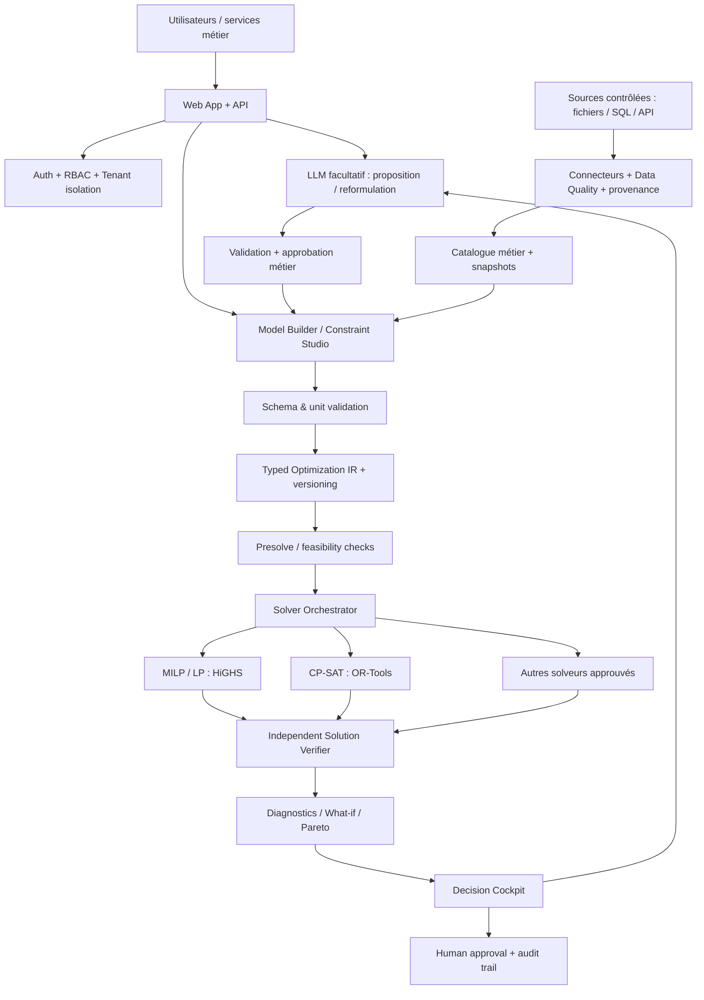

# OPTIMIZATION BRAIN — Spécification complète de la plateforme

> **Nom de travail :** Optimization Brain (OB)  
> **Version du document :** 1.0 — 22 novembre 2026  
> **Type :** Vision produit + PRD + architecture technique + contrat mathématique + plan d'implémentation pour Codex  
> **Statut :** Spécification cible. Les fonctionnalités marquées « cible » **ne sont pas encore développées**.  
> **Langue de travail :** français pour les exigences et l'interface initiale ; noms de code, API et schémas en anglais.  
> **Point de départ :** dépôt `optimization_brain_mvp/`, démonstrateur existant Python / SciPy-HiGHS / FastAPI avec 14 tests réussis.

---

## 0. Instructions de lecture pour Codex (PRIORITÉ ABSOLUE)

Ce document est la source de vérité sur l'objectif du projet. Codex doit :

1. **Lire ce document intégralement**, puis examiner le dépôt réel avant toute modification.
2. **Déterminer ce qui existe** et ce qui reste à implémenter. Ne jamais prétendre qu'une fonction est livrée simplement parce qu'elle apparaît dans cette spécification.
3. **Préserver le MVP existant** et ses tests ; procéder par couches et par petites étapes vérifiables. Ne pas remplacer brutalement le solveur actuel.
4. **Séparer impérativement LLM et Brain mathématique.** Le cœur doit tourner sans accès Internet et sans modèle de langage.
5. **Privilégier le résultat prouvé et auditable** à une réponse qui paraît convaincante. Jamais de « solution optimale » sans preuve/statut approprié.
6. Pour chaque étape : proposer un mini-plan, livrer du code exécutable, exécuter les tests, expliquer les choix et limites, mettre à jour la documentation.
7. **Ne pas coder l'ensemble de la plateforme en une seule demande.** Commencer par le modèle de contraintes universel, le compilateur et une tranche fonctionnelle de bout en bout ; élargir ensuite.
8. Ne pas inventer de données métier. Les données d'exemple sont explicitement synthétiques ; les données réelles exigent source, unité, date, validation et droits d'accès.
9. Conserver un historique des modèles et des exécutions pour reproduire chaque décision.
10. Respecter les critères d'acceptation de la phase courante ; demander un arbitrage seulement en cas de blocage de conception réel.

**Définition du projet en une phrase :** construire une plateforme d'aide à la décision universelle et configurable qui transforme les règles, ressources, objectifs et contraintes d'une organisation en **problèmes d'optimisation mathématique**, les résout, vérifie les résultats et explique les compromis — le LLM restant une interface linguistique facultative et non le moteur de décision.

---

## 1. Vision, périmètre et ambition

### 1.1 Problème à résoudre

Les entreprises, administrations, hôpitaux, universités, ONG et autres structures ont plusieurs équipes qui cherchent à optimiser localement des objectifs souvent contradictoires. Exemples : augmenter les ventes mais respecter une limite de production ; minimiser les coûts mais maintenir la qualité ; améliorer les délais tout en respectant les effectifs ; répartir un budget entre plusieurs programmes concurrents.

Une optimisation locale peut dégrader le résultat global. Optimization Brain coordonne les arbitrages en respectant les obligations de chaque unité et en recherchant les meilleures décisions **pour l'ensemble de l'organisation**.

### 1.2 Ambition produit

Créer un **système d'exploitation de la décision structurée** :

- Fonctionner pour différents secteurs sans réécrire le cœur pour chaque secteur.
- Permettre à une organisation de décrire ses entités, départements, ressources, processus, variables de décision, contraintes et objectifs.
- Détecter les incompatibilités, les impasses et les arbitrages nécessaires.
- Résoudre les problèmes avec des méthodes exactes quand c'est mathématiquement possible et raisonnable en temps de calcul.
- Présenter un statut honnête, les solutions, les bornes, les marges de capacité, les gains par rapport à une référence vérifiée et les hypothèses.
- Pouvoir simuler plusieurs scénarios sans modifier les données approuvées de production.
- Permettre une approbation humaine avant toute décision entraînant une action réelle.
- Conserver une piste d'audit complète.

### 1.3 Hors périmètre au lancement

- Pas de « système magique » qui comprend automatiquement tous les métiers sans configuration.
- Pas de prétention d'optimalité universelle sur des problèmes arbitraires.
- Pas d'exécution d'actions réelles par le LLM.
- Pas de prédiction probabiliste présentée comme vérité.
- Pas de solution métier inventée lorsque les données, contraintes ou unités sont manquantes.
- Pas d'apprentissage par renforcement ou d'algorithme évolutionnaire intégré au MVP simplement pour augmenter la complexité.
- Pas de génération/exécution directe de code Python produit par un utilisateur ou par un LLM.

### 1.4 Cas d'usage visés

| Secteur | Décisions | Contraintes possibles | Mesure de performance |
|---|---|---|---|
| Industrie | volumes, séquencement, sous-traitance | machines, matières, personnel, stocks | profit, service, retard |
| Retail / distribution | allocation de stock, réapprovisionnement | entrepôts, budgets, transports | disponibilité, coût, marge |
| Transport / logistique | routes, tournées, affectations | véhicules, fenêtres horaires, charge | kilomètres, ponctualité |
| Hôpital | répartition de personnel, lits, salles | qualifications, horaires, règles de sécurité | couverture, attente, équité |
| Université | emploi du temps, salles, surveillants | disponibilités, équipements, conflits | couverture, préférences |
| Finance / portefeuille de projets | investissements et projets | budget, dépendances, obligations | valeur créée, risque, équité |
| Secteur public / ONG | répartition de ressources | budget, territoires, priorités sociales | couverture, impact, équité |

**Principe important :** le noyau d'optimisation peut être générique, mais chaque secteur possède des sémantiques, des obligations et des formulaires spécialisés. « Universel » veut dire **extensible par configuration et modules métier**, pas compréhension spontanée de règles jamais décrites.

---

## 2. Contrat de vérité : qu'entend-on par « résultat exact » ?

C'est l'exigence la plus importante du produit.

### 2.1 Distinction obligatoire

1. **Exactitude des données d'entrée :** les capacités, coûts, demandes et règles doivent venir de données validées, avec provenance. Sinon, la qualité du résultat reste limitée.
2. **Validité du modèle :** le modèle doit refléter correctement les règles de l'organisation. Un optimum d'un mauvais modèle n'est pas une bonne décision métier.
3. **Faisabilité mathématique :** la solution respecte toutes les contraintes du modèle, à des tolérances numériques déclarées.
4. **Optimalité mathématique :** le solveur a démontré que l'objectif ne peut être amélioré au-delà des tolérances/bornes fixées.
5. **Réalité opérationnelle :** une solution optimale dans un modèle ne garantit pas un gain réel si la situation change ou si des contraintes ont été omises.

> **Promesse autorisée :** « Nous fournissons des décisions calculées, vérifiées et, lorsque le solveur le démontre, optimales pour un modèle et des données explicitement définis. »  
> **Promesse interdite :** « Nous garantissons toujours la meilleure décision réelle, pour tout problème, en temps limité. »

### 2.2 Résultats et statuts

Statuts publics normalisés :

- `OPTIMAL` : optimalité **certifiée dans les tolérances documentées du solveur** ; conserver les bornes, le gap, les paramètres et la vérification de faisabilité. Un `OPTIMAL` dû seulement à un critère de gap non nul doit être libellé **« optimal à tolérance près »**, pas « optimum exact au sens strict ».
- `FEASIBLE_NOT_PROVEN_OPTIMAL` : solution réalisable, sans preuve d'optimalité complète ; afficher meilleure solution, borne et gap si disponibles.
- `INFEASIBLE` : modèle prouvé infaisable par le solveur ou par un validateur formel ; diagnostic à fournir si possible.
- `UNBOUNDED` : problème non borné ; souvent signe d'une contrainte manquante.
- `TIME_LIMIT_NO_SOLUTION` : temps dépassé, aucune solution réalisable trouvée.
- `UNKNOWN` : statut insuffisant pour affirmer quoi que ce soit.
- `INVALID_MODEL` : schéma, unités, coefficients, règles ou références invalides.
- `SOLUTION_FAILED_VALIDATION` : résultat du solveur refusé par le vérificateur indépendant.
- `SOLVER_ERROR` et `CANCELLED`.

**Attention aux différences entre solveurs :** une étiquette native `OPTIMAL` peut refléter le seuil de gap configuré. Le système doit normaliser ces différences et ne pas transformer un succès numérique en certitude injustifiée.

### 2.3 Mesures à conserver

Toute exécution doit enregistrer au minimum : `run_id`, `model_version`, `data_snapshot_id`, `scenario_id`, `model_hash`, `solver_name`, `solver_version`, `solver_options`, `solver_status_raw`, `public_status`, `objective_value`, `best_bound`, `absolute_gap`, `relative_gap`, `primal_residual_max`, `integrality_residual_max`, `started_at`, `duration_ms`, `solution`, `validation_report`, `warnings` et `audit_actor_id`.

Si une valeur n'est pas fournie par le backend, renvoyer `null` ; ne jamais fabriquer un certificat, une borne ou un gap.

### 2.4 Tolérances et arithmétique

- Les problèmes MILP/LP peuvent utiliser des calculs flottants ; documenter précisément les tolérances et conserver les données non arrondies lors de la vérification.
- Pour les montants : privilégier `Decimal` aux frontières API/DB, stocker les unités monétaires et leur précision ; convertir de manière contrôlée vers les coefficients des solveurs.
- Pour CP-SAT : utiliser des entiers et des facteurs d'échelle déclarés, en vérifiant les risques de dépassement de capacité numérique.
- Ne jamais arrondir une solution entière puis la considérer automatiquement valide : **revérifier toutes les contraintes après conversion**.
- Pour les problèmes exigeant des certificats mathématiques symboliques ou rationnels stricts : ajouter ultérieurement un mode spécialisé ; ne pas appeler les résultats flottants « exacts au bit près ».

### 2.5 Objectif du design

Un résultat doit être **reproductible, explicable, vérifiable et qualifié honnêtement**. L'exactitude n'est pas synonyme de prédiction ; le Brain optimise un problème posé, il n'invente pas le futur.

---

## 3. Utilisateurs, rôles et workflow

### 3.1 Profils utilisateurs

- **Platform Admin** : gère l'installation, les organisations et les politiques techniques.
- **Organization Admin** : gère les membres, rôles et départements de son organisation.
- **Model Builder / Operations Research Analyst** : crée des modèles et valide les équations, domaines et unités.
- **Department Owner** : déclare et approuve les ressources, contraintes et objectifs de son équipe.
- **Decision Maker / Approver** : compare les scénarios et approuve un plan avant exécution.
- **Operator** : consulte le plan approuvé et exécute la partie autorisée.
- **Auditor / Viewer** : lit les modèles, hypothèses et journaux sans les modifier.

### 3.2 Parcours principal

1. L'organisation crée un espace et enregistre ses départements.
2. Elle configure les entités : sites, produits, équipes, machines, services, projets, etc.
3. Chaque département ajoute ses données, objectifs et contraintes, éventuellement via l'interface conversationnelle.
4. Le LLM **propose** une interprétation structurée. Un moteur de validation vérifie et un responsable approuve les règles sensibles.
5. Le Brain compile les règles et détecte les erreurs avant de lancer le solveur.
6. L'utilisateur choisit une politique d'optimisation : objectif unique, lexicographique, objectifs multiples, scénario alternatif.
7. Le Brain calcule, vérifie, classe et historise le résultat.
8. L'interface montre recommandations, contraintes saturées, pertes de compromis, incertitudes, preuves et rapports.
9. La décision est approuvée, rejetée ou renvoyée pour ajustement. Toute modification crée une nouvelle version.
10. Les résultats observés ultérieurement peuvent être comparés au plan calculé, sans réécrire l'historique.

---

## 4. Modèle conceptuel universel (indépendant d'un secteur)

**La grande innovation d'architecture est la séparation entre :**

- **Ontology / Business Model** : ce qui existe dans l'organisation.
- **Optimization Model** : ce qui peut changer, ce qui doit être respecté, ce qui doit être optimisé.
- **Solver Backend** : l'algorithme qui traite la formulation.
- **Decision Governance** : qui a le droit de définir, calculer, approuver et appliquer.

### 4.1 Objets fondamentaux

| Objet | Sens | Exemples |
|---|---|---|
| `Organization` | structure possédant ses données et règles | entreprise, hôpital, université |
| `Department` | équipe responsable d'une partie des règles | finance, RH, production |
| `EntityType` | type d'objet métier | salarié, commande, salle, véhicule |
| `Entity` | instance | machine #12, commande #740 |
| `Resource` | quantité limitée et partageable | heures machine, euros, lits |
| `Activity` | opération consommatrice/productrice | fabriquer, livrer, affecter |
| `Parameter` | donnée fixée et vérifiée | demande, tarif, capacité |
| `DecisionVariable` | valeur recherchée par le solveur | quantités, sélection, ordre, affectation |
| `Constraint` | règle mathématique | budget ≤ 8 000 €, 1 agent par service |
| `Objective` | fonction à maximiser/minimiser | marge, délai, couverture |
| `Policy` | priorités et droits de modification | priorité à la sécurité |
| `Scenario` | ensemble isolé d'hypothèses | ajouter 2 véhicules |
| `OptimizationRun` | exécution versionnée et traçable | calcul #123 |
| `VerifiedSolution` | décision validée mathématiquement | plan d'affectation |
| `Approval` | autorisation humaine | plan adopté par le directeur |

### 4.2 Contraintes

Chaque contrainte possède :

- `id`, `name`, `description`, `department_id`, `owner_id` ;
- expression mathématique typée et opérateur (`<=`, `>=`, `==`, puis structures avancées) ;
- type `HARD` ou `SOFT` ;
- `unit`, `valid_from`, `valid_to`, `source_id`, `version` ;
- niveau de priorité, confidentialité, règles d'édition et justification ;
- pour une règle souple : variables de violation, mesure de déviation, pénalité/priorité formellement définies.

**Règle critique :** une contrainte obligatoire ne peut pas devenir souple parce que le modèle est infaisable. Toute relaxation nécessite une politique de gouvernance explicite et éventuellement une approbation.

### 4.3 Typage obligatoire

- Domaines : `BINARY`, `INTEGER`, `CONTINUOUS`, puis `INTERVAL`, `SET`, `SEQUENCE` avec adaptateur approprié.
- Unités : EUR/MAD, minutes/heures, pièces, tonnes, mètres, pourcentages, etc.
- Dimensions et ensembles indexés : `product`, `site`, `team`, `date`, `vehicle`, `project`.
- Calendriers : fuseau horaire, jours ouvrés, jours fériés, granularité, périodes.
- Références : toutes les expressions doivent lier des identifiants déclarés.
- Propriétés : borne inférieure/supérieure, domaine, multiplicité, source de la donnée.

Le compilateur doit rejeter par exemple `€ + heures`, une référence inconnue, un coefficient non fini ou un produit de variables envoyé à un backend purement linéaire.

### 4.4 Extensibilité métier

Construire un **noyau de modélisation générique** et des **templates métier versionnés** :

- `production_planning`
- `workforce_scheduling`
- `transport_assignment`
- `resource_allocation`
- `project_portfolio_selection`
- `university_timetabling`

Chaque template définit son schéma métier, ses transformations validées vers l'IR (représentation intermédiaire) et ses tests de référence. Aucun template ne doit contourner la validation ou le contrôle des accès.

---

## 5. Architecture fonctionnelle de la plateforme cible



### 5.1 Services et responsabilités

1. **Identity & Organization Service** : tenants, utilisateurs, équipes, droits.
2. **Data Catalog & Connectors** : imports, provenance, snapshots immuables, mapping des colonnes.
3. **Constraint Studio** : éditeur manuel typé + propositions du LLM, validation métier.
4. **Model Compiler** : transforme la DSL et les templates en une IR mathématique versionnée.
5. **Model Validator & Presolver** : cohérence dimensionnelle, bornes, doublons, contraintes triviales, formulation supportée.
6. **Solver Orchestrator** : analyse les caractéristiques du problème, sélectionne un backend compatible et applique les limites de calcul.
7. **Solver Adapters** : API commune vers MILP/LP, CP-SAT puis solveurs spécialisés.
8. **Solution Verifier** : vérification séparée des contraintes, domaines, intégralité et valeur de l'objectif.
9. **Infeasibility & Explanation Engine** : diagnostics, scénarios, coûts d'opportunité calculés, comparaisons.
10. **Decision Workspace** : cockpit, KPI, comparaison, validation, export.
11. **Audit & Observability** : reproductibilité, journaux, métriques de performance, changements de règles.
12. **LLM Gateway (optionnel)** : extraction des intentions, reformulation, explication sur JSON vérifié.

### 5.2 Frontière de confiance

Le LLM est explicitement **non fiable pour les décisions mathématiques**. Il peut proposer un brouillon ; il ne peut ni injecter des contraintes exécutables ni modifier une version publiée sans autorisation. Les fichiers importés et les données texte sont également non fiables tant qu'ils n'ont pas passé validation et approbation.

### 5.3 Interfaces entre moteurs

Chaque solveur doit implémenter conceptuellement :

```python
class SolverAdapter(Protocol):
    def supports(self, model: OptimizationIR) -> SupportReport: ...
    def solve(self, model: OptimizationIR, settings: SolveSettings) -> RawSolveResult: ...
    def get_capabilities(self) -> SolverCapabilities: ...
```

Le compilateur n'invente pas une traduction : si un backend ne supporte pas certaines contraintes, il rejette avec un message explicite ou utilise une reformulation **prouvée équivalente**, documentée et testée.

---

## 6. Le Brain mathématique : définition et fondations

### 6.1 Formulation canonique initiale

Pour les problèmes MILP linéaires :

\[
\begin{aligned}
\max\quad & c^T x\\
\text{sous contraintes}\quad & A x \le b,\\
& E x = d,\\
& \ell \le x \le u,\\
& x_j \in \mathbb{Z}\quad (j \in I),\\
& x_k \in \{0,1\}\quad (k \in B).
\end{aligned}
\]

- `x` : décisions ;
- `c` : coefficients de l'objectif ;
- `A,b,E,d` : contraintes ;
- `I,B` : variables entières et binaires ;
- `ell,u` : bornes.

Viennent ensuite les contraintes de calendrier, les implications logiques, les réseaux, et éventuellement les non-linéarités selon les capacités de chaque backend.

### 6.2 Objectifs multiples

Ne pas additionner arbitrairement des euros, des jours et des indicateurs de qualité. Méthodes à proposer :

- **Lexicographique** : priorité 1, puis optimiser priorité 2 sans dégrader priorité 1 au-delà d'une tolérance définie.
- **Somme pondérée** : seulement après normalisation des objectifs et approbation de poids explicites.
- **Epsilon-constraint** : optimiser un objectif en imposant des seuils aux autres ; explorer les compromis.
- **Pareto** : afficher des solutions non dominées et les compromis ; éviter de présenter un unique score comme « vérité ».
- **Goal programming** : minimiser des déviations par rapport à des cibles métier déclarées.

Les contraintes `HARD` sont prioritaires sur les objectifs ; ne pas sacrifier une règle légale pour améliorer une métrique commerciale.

### 6.3 Stratégie des solveurs

| Famille | Usage adapté | Premier backend envisagé |
|---|---|---|
| LP / MILP | budgets, allocations, production, sélection | HiGHS via SciPy dans le MVP ; adaptateur dédié ensuite |
| CP-SAT | horaires, affectations, combinatoire et logique discrète | Google OR-Tools |
| Graph algorithms | flot, plus courts chemins, réseaux spécifiques | bibliothèques et modules spécialisés |
| Network flows | transport, affectations, circulation de flux | OR-Tools ou backend adapté |
| Multiobjective | compromis entre départements | orchestration séquentielle sur solveurs exacts |
| Robust / stochastic | variations de demande et capacités | modules ultérieurs avec hypothèses explicites |
| Decomposition | très gros problèmes structurés | Benders, décomposition lagrangienne si benchmark justifie |

**Pas d'optimisation algorithmique naïve :** plus complexe ne signifie ni plus exact ni plus rapide. Toute nouvelle méthode doit battre une baseline sur un jeu de benchmarks reproductibles ou débloquer une catégorie de problèmes auparavant impossible.

### 6.4 Choix automatique contrôlé du solveur

Le routeur inspecte : types de variables, linéarité, présence d'intervalles, tailles, densité de matrice, priorités, limites de temps, tolérance souhaitée et licence autorisée. Il choisit **seulement** un solveur capable d'exprimer correctement le modèle. L'utilisateur expert peut fixer explicitement un backend.

### 6.5 Modes d'exécution

- `CERTIFY` : chercher une preuve d'optimalité dans une limite de calcul ; remonter le statut réel.
- `BEST_EFFORT` : renvoyer la meilleure solution réalisable trouvée avec borne/gap lorsqu'ils existent.
- `FEASIBILITY_ONLY` : déterminer si une solution est possible ; si possible produire un témoin réalisable.
- `DIAGNOSE` : analyser les raisons d'infaisabilité selon les capacités du solveur.
- `SCENARIO_BATCH` : évaluer de multiples hypothèses/versionnements.

Ne pas appeler `CERTIFY` une garantie de succès ; cela décrit une intention de calcul, pas un certificat assuré.

---

## 7. Langage de modélisation universel — DSL v1

### 7.1 Principes de conception

La DSL (Domain-Specific Language) est un **format JSON strict**, versionné et validé côté backend. Elle permet d'exprimer un problème sans écrire de code arbitraire. La version 1 supporte les expressions linéaires sur variables bornées et indexées ; versions futures supporteront des constructions structurées (intervalles, contraintes globales, réseaux, etc.).

Caractéristiques obligatoires :

- Schéma JSON + modèles Pydantic stricts, champs inconnus rejetés.
- Identifiants stables, références résolues, bornes explicites.
- Coefficients numériques finis et sérialisés précisément (chaînes décimales recommandées aux frontières).
- Typage des unités et opérations dimensionnellement cohérentes.
- Métadonnées `department`, `source`, `approved`, `version`.
- Références à des paramètres/datasets approuvés ; pas de texte libre comme expression exécutable.
- Pas d'`eval`, pas d'exécution SQL libre, pas de scripts Python à partir des contraintes.

### 7.2 Exemple complet de modèle inter-départements

Cas synthétique : une entreprise choisit les quantités de deux produits `A` et `B`. Les Ventes définissent la demande, la Production la capacité machine, la Finance les dépenses autorisées, la Logistique le volume expédiable. L'objectif est de maximiser une contribution économique mesurée en EUR.

```json
{
  "schema_version": "1.0",
  "id": "demo_cross_department",
  "name": "Allocation de production et livraison",
  "currency": "EUR",
  "parameters": {
    "machine_capacity_hours": {"value": "100", "unit": "hour", "source": "demo"},
    "operating_cash_budget_eur": {"value": "8000", "unit": "EUR", "source": "demo"},
    "delivery_capacity_units": {"value": "55", "unit": "unit", "source": "demo"}
  },
  "variables": [
    {"id": "qty_A", "type": "INTEGER", "lb": "0", "ub": "40", "unit": "unit", "department": "sales"},
    {"id": "qty_B", "type": "INTEGER", "lb": "0", "ub": "35", "unit": "unit", "department": "sales"}
  ],
  "constraints": [
    {
      "id": "production_machine",
      "owner_department": "production",
      "kind": "HARD",
      "terms": [{"variable": "qty_A", "coefficient": "2", "coefficient_unit": "hour/unit"}, {"variable": "qty_B", "coefficient": "1", "coefficient_unit": "hour/unit"}],
      "operator": "<=", "rhs": "100", "unit": "hour"
    },
    {
      "id": "finance_budget",
      "owner_department": "finance",
      "kind": "HARD",
      "terms": [{"variable": "qty_A", "coefficient": "100", "coefficient_unit": "EUR/unit"}, {"variable": "qty_B", "coefficient": "200", "coefficient_unit": "EUR/unit"}],
      "operator": "<=", "rhs": "8000", "unit": "EUR"
    },
    {
      "id": "logistics_delivery",
      "owner_department": "logistics",
      "kind": "HARD",
      "terms": [{"variable": "qty_A", "coefficient": "1", "coefficient_unit": "unit/unit"}, {"variable": "qty_B", "coefficient": "1", "coefficient_unit": "unit/unit"}],
      "operator": "<=", "rhs": "55", "unit": "unit"
    }
  ],
  "objectives": [
    {
      "id": "maximize_contribution",
      "sense": "MAX",
      "priority": 1,
      "terms": [{"variable": "qty_A", "coefficient": "80", "coefficient_unit": "EUR/unit"}, {"variable": "qty_B", "coefficient": "60", "coefficient_unit": "EUR/unit"}],
      "unit": "EUR"
    }
  ]
}
```

**Résultat de référence vérifiable par énumération exhaustive** : `qty_A = 40`, `qty_B = 15`, contribution `4 100 EUR` ; utilisation machine `95/100 h`, budget `7 000/8 000 EUR`, logistique `55/55 unités`. Cela permet d'écrire un **golden test** contrôlant la compilation, la résolution, la faisabilité et l'objectif.

Les paramètres et leur répétition numérique dans cet exemple sont pédagogiques. Dans le produit, l'éditeur doit permettre de référencer `parameters.*` dans les membres droits et les coefficients afin d'éviter les doubles saisies et toute divergence ; ne pas créer deux sources de vérité.

### 7.3 Format compilé interne (IR)

L'IR ne doit dépendre ni de React, ni du LLM, ni du secteur métier. Exemple conceptuel :

```text
OptimizationIR
├── metadata: ids, hashes, provenance, model_version
├── variable_registry: typed variables, domains, bounds, units
├── parameter_registry: immutable validated values
├── constraints: normalized sparse expressions + metadata
├── objectives: normalized expressions + priority / sense
├── scale_profile: unit scaling / numeric tolerances
└── compilation_report: transformations, warnings, unsupported constructs
```

Le `model_hash` doit être calculé à partir d'une sérialisation canonique des données **qui influencent le calcul**. Les dates de création, libellés d'affichage non sémantiques et métadonnées volatiles ne doivent pas entraîner des changements de hash arbitraires. Conserver séparément un hash de la totalité du manifeste d'audit si nécessaire.

### 7.4 Validation pré-solveur

- Validité de la structure, types et références.
- Cohérence d'unités (`hour`, `EUR`, `unit`, etc.).
- Bornes compatibles (`lb <= ub`).
- Domaines binaires/intégralité cohérents.
- Absence de coefficients infinis ou `NaN`.
- Gestion explicite des objectifs multiples et priorités.
- Signaux d'infaisabilité évidents (min > max, demande > capacité maximale, etc.).
- Contrôles d'accès sur les paramètres/contraintes et approbations.
- Estimation de complexité et compatibilité solveur.
- Absence de redéfinition silencieuse d'une contrainte obligatoire.

---

## 8. Compilation, résolution et vérification

### 8.1 Pipeline obligatoire

```text
Validated business input
    -> Canonical DSL
    -> Semantic + permissions + units validation
    -> Immutable parameter snapshot
    -> Typed OptimizationIR
    -> Presolve / simplification with trace
    -> Solver selection
    -> Solve with resource limits
    -> Raw result + bounds + diagnostics
    -> Independent verification
    -> Trusted public result + immutable audit record
```

### 8.2 Vérification indépendante

Implémenter un `SolutionVerifier` séparé de `SolverAdapter`, responsable de :

- calculer chaque membre gauche de contrainte à partir des valeurs de solution et des coefficients du modèle canonique ;
- contrôler domaines, bornes et intégralité ;
- mesurer le résidu de chaque contrainte et le résidu maximal ;
- recalculer les objectifs de façon indépendante ;
- comparer avec les objectifs déclarés par le solveur ;
- enregistrer toutes les contraintes violées et tolérances applicables ;
- refuser toute solution invalide avant affichage comme décision exploitable.

La vérification de la **faisabilité** est distincte de la **preuve d'optimalité**. Une évaluation indépendante ne suffit pas, à elle seule, à prouver que la solution est optimale : la preuve repose notamment sur les bornes et le statut attestés par le solveur, et éventuellement sur un certificat vérifiable lorsqu'il existe.

### 8.3 Contrôles de ressources

Limiter le temps CPU, la mémoire des workers, la concurrence des jobs, la taille des modèles, le nombre de scénarios et les fichiers importés. Fournir `cancel`, état courant et `timeout` sans exposer l'instance du solveur à des actions arbitraires venant de l'utilisateur.

### 8.4 Résultats JSON normalisés

```json
{
  "run_id": "run_001",
  "public_status": "OPTIMAL",
  "certificate_scope": "solver_tolerances",
  "model_version": "1.0.0",
  "scenario_id": "base",
  "objective": {"name": "maximize_contribution", "value": "4100", "unit": "EUR"},
  "decision_values": {"qty_A": 40, "qty_B": 15},
  "bounds": {"best_bound": "4100", "absolute_gap": "0", "relative_gap": "0"},
  "verification": {"feasible": true, "violated_constraints": [], "max_residual": "0"},
  "diagnostics": {"binding_constraints": ["logistics_delivery"]},
  "provenance": {"data_snapshot_id": "demo_v1", "solver": "highs", "solver_version": "record_actual_version"}
}
```

Ceci est **un exemple de contrat**, pas une réponse API déjà implémentée. Les champs de certificat/bornes ne doivent être remplis qu'avec des valeurs réelles et justifiées.

---

## 9. Gestion de l'infaisabilité et des conflits inter-départements

### 9.1 Exigence

Si plusieurs départements imposent des règles incompatibles, le Brain ne doit **pas** inventer une solution ni modifier silencieusement les contraintes.

Exemple : Ventes impose au moins 120 unités, Production ne peut en fabriquer que 90 et aucune sous-traitance n'est autorisée. Le bon résultat est `INFEASIBLE`, avec diagnostic.

### 9.2 Diagnostics à construire par étapes

1. **Analyse statique** de bornes et de contradictions évidentes.
2. **Identification d'un sous-ensemble incompatible** (`IIS` ou mécanisme analogue) quand le backend le prend en charge ; expliquer que ce sous-ensemble n'est pas nécessairement l'unique cause.
3. **Assumptions / unsat cores** pour contraintes logiques CP-SAT, si supportés.
4. **Elastic relaxation** strictement séparée du problème original : proposer quelles modifications minimales des règles **autorisées** rendraient le modèle réalisable.
5. **Rapport de négociation** par département : impact et autorisation nécessaire.

Le système doit afficher la différence entre une **contrainte impossible**, une **contrainte saturée** et une **contrainte coûteuse**. Une contrainte saturée n'a pas nécessairement un prix d'ombre positif, particulièrement dans un problème entier.

---

## 10. Scénarios, sensibilité et gains réels

### 10.1 Scénarios

La plateforme doit permettre :

- copier une référence approuvée en scénario isolé ;
- changer une capacité, un budget, une demande ou une règle autorisée ;
- résoudre plusieurs scénarios en parallèle selon des quotas ;
- comparer objectif, faisabilité, plans, contraintes saturées, ressources inutilisées ;
- montrer les décisions qui changent entre deux solutions ;
- garder le scénario de référence inchangé.

### 10.2 Définition d'un gain

**Gain calculé = mesure du plan optimisé − mesure du plan de référence**, pour une métrique maximisée. Le plan de référence doit :

- être identifié (`baseline_plan_id`) ;
- être valide dans le **même modèle et avec le même snapshot de données**, ou la comparaison doit être clairement qualifiée ;
- avoir sa métrique recalculée indépendamment ;
- être affiché avec les coûts de transition et de mise en œuvre lorsque ceux-ci font partie du modèle.

Un résultat sans baseline fiable doit afficher « valeur optimisée », **pas** « gain de 27 % ».

### 10.3 Sensibilité

- Tester des variations paramétriques dans un périmètre déterminé.
- Afficher les seuils où une nouvelle ressource crée de la valeur.
- Différencier prix d'ombre LP, effets marginaux MILP par résolution, et dérivées approximatives.
- Ne jamais présenter une corrélation ou une contrainte saturée comme une causalité prouvée.
- Pour l'incertitude : scénarios prudents/centraux/hauts et optimisation robuste/stochastique seulement si les données et hypothèses sont définies ; ne pas les présenter comme prédictions certaines.

---

## 11. LLM : rôle facultatif, limité et contrôlé

### 11.1 Ce qu'il peut faire

- Comprendre une demande en langage naturel.
- Proposer la traduction en objets métiers, paramètres, contraintes et objectifs de la DSL.
- Détecter les champs manquants et demander des précisions.
- Reformuler des contraintes pour l'utilisateur.
- Expliquer, en langage naturel, les résultats **déjà calculés et vérifiés**.
- Générer un rapport à partir d'un artefact numérique déterministe.

### 11.2 Ce qu'il ne peut pas faire

- Fixer silencieusement des budgets, capacités ou coefficients non fournis.
- Affirmer que telle allocation est optimale sans résultat de solveur.
- Modifier les règles `HARD` en règles `SOFT`.
- Exécuter du code, SQL libre ou commandes système provenant du prompt.
- Changer un modèle publié, approuvé ou utilisé dans une décision passée.
- Exécuter un plan opérationnel sans droits et validation humaine.
- Voir les données d'un autre tenant ou des données confidentielles sans autorisation.

### 11.3 API de proposition

```text
NL request -> LLM -> ConstraintProposal (strict JSON)
-> schema validation -> semantic validation -> provenance check
-> impact preview -> department-owner approval
-> published model version -> Brain
```

Le LLM reçoit préférentiellement des catalogues et identifiants de champs, non les données sensibles brutes. Les résultats numériques restent vérifiés côté serveur et ne doivent pas être recalculés en langage naturel.

### 11.4 Test d'indépendance

**Test obligatoire :** déconnecter toutes les clés/API LLM, lancer un cas d'optimisation par JSON/API/CLI, obtenir la même formulation et la même décision vérifiée (à paramètres/seed/solveur équivalents). Les jobs de résolution ne dépendent d'aucun service de langage.

---

## 12. Interfaces web : plateforme complète

### 12.1 Direction UX

Interface professionnelle, épurée, orientée données et décisions. Navigation claire, visualisations utiles, couleurs sobres, support desktop prioritaire, accessibilité clavier, unités explicites et états de chargement/erreurs sérieux. Une interface moderne ne doit pas cacher les raisons mathématiques de la décision.

### 12.2 Pages à construire

1. **Sign-in / Organization Switcher** : authentification et sélection du tenant.
2. **Organization Overview** : carte des départements, ressources et derniers runs.
3. **Department Workspace** : contraintes, objectifs, données et responsables d'un département.
4. **Business Data Catalog** : imports, mappings, sources, validation, snapshots.
5. **Model Builder / Constraint Studio** : éditeur visuel + formulaire typé + vue mathématique + validation.
6. **Objectives & Priorities** : objectifs, seuils, niveaux lexicographiques, poids éventuels.
7. **Optimization Control Center** : configuration du solveur, jobs, statut, ressources, historique.
8. **Decision Cockpit** : KPIs, allocations détaillées, contraintes actives, preuve et qualité de la solution.
9. **Scenario Lab** : comparaison de scénarios et variations de paramètres.
10. **Conflict Resolution** : diagnostics d'infaisabilité et modifications proposées pour approbation.
11. **Approvals / Decision Log** : validateur, commentaires, plan approuvé et exports.
12. **Administration & Audit** : droits, quotas, logs, versions, intégrations.
13. **Assistant de formulation (optionnel)** : saisir une intention métier, obtenir un brouillon de modèle et afficher ce qui a été validé ou rejeté.

### 12.3 Vues essentielles du Decision Cockpit

- `Model & data version` et horodatage.
- Statut exact (`OPTIMAL`, `FEASIBLE...`, etc.) et tolérances.
- Valeur d'objectif et unité.
- Comparaison à une baseline vérifiée si disponible.
- Top allocations / décisions par ressource, produit, équipe, site.
- Contraintes actives, résidu, capacité restante.
- Raisons de non faisabilité et suggestions **non appliquées**.
- `Best bound`, `gap`, solveur, durée, limites.
- Tableau « Ce que le solveur a décidé » / « Ce que l'organisation peut ajuster ».
- Export traçable JSON/CSV, puis PDF si besoin.

---

## 13. Stack technique recommandée

> Choix de conception initial, pas obligation définitive. Valider chaque dépendance et sa licence avant déploiement réel.

| Couche | Choix | Raison |
|---|---|---|
| Langage core | Python 3.11+ | écosystème OR et tests ; compatibilité avec le socle existant |
| API backend | FastAPI + Pydantic v2 | contrats validés, OpenAPI |
| ORM / migrations | SQLAlchemy 2 + Alembic | schéma et évolutions |
| Base de données | PostgreSQL | cohérence, requêtes, JSONB et audit |
| Jobs de résolution | Redis + RQ ou Celery | traitements longs, queue, annulation |
| Frontend | React + TypeScript + Vite | application orientée interactions |
| Styles / composants | Tailwind CSS + composants accessibles | interface uniforme |
| MILP/LP | conserver d'abord SciPy / HiGHS ; couche d'adaptation dédiée | profiter du MVP existant |
| CP-SAT | Google OR-Tools | contraintes combinatoires / horaires |
| Validation | JSON Schema / Pydantic + moteur d'unités | robustesse des modèles |
| Observabilité | logs structurés + OpenTelemetry (évolution) | audit et diagnostics |
| Tests | pytest + tests API + Playwright (UI) | qualité de bout en bout |
| Déploiement local | Docker Compose | environnement reproductible |
| CI | GitHub Actions ou équivalent | tests / lint / builds |

**Pragmatisme :** au début, un monolithe modulaire backend et un worker séparé suffisent. Ne pas créer des microservices prématurément. Le Brain doit être une bibliothèque Python importable et testable indépendamment du serveur HTTP.

### 13.1 Structure cible du dépôt

```text
optimization-brain/
├── AGENTS.md                         # consignes courtes de développement pour Codex
├── OPTIMIZATION_BRAIN_SPEC.md        # ce document
├── README.md                         # installation et état réellement livré
├── docs/
│   ├── architecture.md
│   ├── decision-records/
│   ├── model-dsl.md
│   ├── solver-contract.md
│   ├── API.md
│   └── roadmap.md
├── backend/
│   ├── pyproject.toml
│   ├── src/optimization_brain/
│   │   ├── core/                    # IR, DSL, validation, unités
│   │   ├── compiler/                # DSL -> IR -> backend
│   │   ├── solvers/                 # registry, highs, cp_sat
│   │   ├── verification/            # recalcul indépendant
│   │   ├── diagnostics/             # infeasible / slack / Pareto
│   │   ├── domain_templates/        # production, staffing, etc.
│   │   ├── data/                    # catalog, snapshots, connectors
│   │   ├── governance/              # approval, auth, audit
│   │   ├── llm_gateway/             # facultatif, isolé
│   │   ├── jobs/                    # queues, workers
│   │   └── api/                     # REST versionné
│   └── tests/
│       ├── unit/
│       ├── integration/
│       ├── golden/
│       └── property/
├── frontend/
│   ├── src/
│   │   ├── app/
│   │   ├── pages/
│   │   ├── features/
│   │   ├── components/
│   │   └── api/
│   └── tests/
├── legacy_mvp/                      # socle archivé/encapsulé puis migré sans régression
├── examples/
│   ├── generic_allocation/
│   ├── production/
│   └── workforce/
├── benchmarks/
├── infra/
│   ├── docker-compose.yml
│   └── migrations/
└── .github/workflows/
```

Le code legacy peut rester dans sa structure actuelle au début. Ne déplacer les modules qu'une fois une suite de tests et une compatibilité validées ; éviter les changements d'arborescence sans nécessité.

---

## 14. Modèle de données et stockage

### 14.1 Tables/logical collections minimales

- `organizations(id, name, settings, created_at)`
- `users(id, ..., auth_subject)` et `memberships(user_id, organization_id, role)`
- `departments(id, organization_id, name, owner_id)`
- `data_sources(id, organization_id, source_type, configuration_ref, owner_id)`
- `data_snapshots(id, organization_id, source_id, content_hash, captured_at, validation_state)`
- `models(id, organization_id, name, current_version_id)`
- `model_versions(id, model_id, canonical_dsl, semantic_hash, author_id, approval_state, created_at)`
- `model_constraints(id, model_version_id, department_id, hard_soft, provenance_ref, ...)` (si nécessaire pour requêtes ; la version canonique reste source de vérité)
- `scenarios(id, model_version_id, parent_id, parameters_override, data_snapshot_id)`
- `optimization_runs(id, organization_id, scenario_id, status, solver_metadata, input_hash, result_ref, created_at, completed_at)`
- `solution_artifacts(id, run_id, result_json, verification_report, immutable_hash)`
- `approvals(id, organization_id, target_type, target_id, actor_id, decision, comments, timestamp)`
- `audit_events(id, organization_id, actor_id, action, target_ref, previous_hash, new_hash, at)`

Toutes les données sensibles sont isolées par organisation et soumises au contrôle des droits à l'accès, pas seulement à l'affichage. Les jobs et exports doivent porter l'identité/tenant autorisés.

### 14.2 Provenance et versionnage

- Une exécution référence exactement une version de modèle, un snapshot de paramètres et un réglage de solveur.
- Les modèles publiés sont immuables ; une modification crée une nouvelle version.
- Garder un journal des transformations de DSL vers IR.
- Ne pas écraser une solution passée au motif qu'une meilleure configuration existe aujourd'hui.
- Prévoir politiques de rétention, suppression autorisée et confidentialité.

---

## 15. API cible (REST v1)

### 15.1 Conventions

- Préfixe `/api/v1` ; réponse JSON ; OpenAPI généré.
- Toute requête utilise l'authentification, un tenant autorisé et des schémas stricts, sauf endpoints de santé explicitement publics.
- Les jobs longs répondent `202 Accepted` avec un `run_id` ; le client consulte ensuite le statut.
- Les modifications critiques requièrent une version/ETag et une approbation si applicable.
- `Idempotency-Key` sur création de jobs et actions réessayables.

### 15.2 Endpoints principaux

| Endpoint | Usage |
|---|---|
| `POST /organizations` | créer une organisation autorisée |
| `GET /organizations/{id}/departments` | liste des unités |
| `POST /data-sources/imports` | importer un fichier dans un espace isolé |
| `GET /data-snapshots/{id}` | consulter provenance et validation |
| `POST /models` | créer un modèle en brouillon |
| `POST /models/{id}/versions` | enregistrer une nouvelle version |
| `POST /models/validate` | validation syntaxique/sémantique/permissions |
| `POST /models/{id}/publish` | publier selon la gouvernance |
| `POST /scenarios` | créer un scénario versionné |
| `POST /optimization-runs` | lancer un solveur async |
| `GET /optimization-runs/{id}` | statut, métriques, warnings |
| `GET /optimization-runs/{id}/solution` | variables de décision et valeurs |
| `GET /optimization-runs/{id}/verification` | rapport de vérification |
| `POST /optimization-runs/{id}/cancel` | demander l'annulation |
| `POST /scenarios/compare` | comparer des résultats existants |
| `POST /models/{id}/diagnose` | analyse d'infaisabilité |
| `POST /approvals` | approuver/rejeter une version/solution |
| `GET /audit-events` | historique avec filtrage d'accès |
| `POST /llm/constraint-proposals` | **facultatif** : proposer une formulation non publiée |

L'endpoint legacy `POST /optimize` reste compatible pendant la migration ; prévoir un adaptateur au lieu de le casser immédiatement.

### 15.3 Comportement en cas d'erreur

- `400` : requête mal formée ; `401` : non authentifié ; `403` : non autorisé ; `404` : ressource inconnue ;
- `409` : conflit de version ; `422` : modèle formellement invalide ; `429` : quota ;
- résultat mathématique `INFEASIBLE` **n'est pas une erreur HTTP 500** ; c'est un statut de calcul dans la réponse du job.
- Erreurs détaillées et localisées dans le modèle (ex. contrainte, unité, référence) sans fuite de secrets.

---

## 16. Sécurité, gouvernance et fiabilité

### 16.1 Sécurité

- Authentification robuste et rôles côté serveur ; vérification tenant systématique.
- Secret management pour les connecteurs ; aucun mot de passe en code ou dans les logs.
- Validation stricte des fichiers et limitation de taille / type.
- Prévention des injections SQL, CSV formula injection à l'export, XSS et SSRF sur connecteurs.
- Ne pas exposer au navigateur de paramètres confidentiels sans autorisation.
- Pas d'exécution de contenu utilisateur (`eval`, `exec`, shell, `pickle` non sûr).
- Rate limits, quotas solveur, mémoire, CPU, concurrence et annulation.
- Audit des changements de contraintes et des validations.
- Les données santé/personnel exigent une attention renforcée, des droits fins et le respect des règles applicables.

### 16.2 Gouvernance des décisions

- Chaque contrainte porte son propriétaire ; un autre département ne peut pas la supprimer librement.
- Pour une décision engageante, la plateforme fournit le plan, les coûts, les compromis, les risques du modèle et l'identité de l'approbateur.
- Une recommandation n'est **pas** automatiquement une instruction d'exécution.
- Une demande métier ambiguë reste en brouillon jusqu'à clarification/validation.
- Le Brain ne doit jamais rendre « une solution » en contournant discrètement des obligations.

### 16.3 Exigences non fonctionnelles initiales (cibles mesurables)

- Tests unitaires déterministes et golden cases exécutés en CI.
- API réactive pour création/consultation ; calcul d'optimisation en tâche asynchrone.
- Temps maximal et tailles limites configurables par environnement/tenant.
- Traces de corrélation `request_id/run_id` et logs structurés sans secrets.
- Environnement local reproductible sur Windows 10 + Docker Desktop / VS Code, plus Linux CI.
- Base de données avec migrations versionnées et sauvegardes en production.
- Évaluation des performances sur des modèles gradués (petit/moyen/grand) avant d'annoncer des SLA.
- Accessibilité et états d'erreur cohérents.

---

## 17. Méthodologie de tests et preuve de qualité

### 17.1 Tests indispensables

1. **Schema tests** : champs inconnus, valeurs négatives, `NaN`, références absentes, unités incompatibles.
2. **Compiler tests** : la même DSL produit la même IR canonique ; chaque terme et contrainte a une correspondance.
3. **Golden tests** : petites instances à optimum connu par énumération exhaustive ; inclure l'exemple `qty_A=40`, `qty_B=15`, objectif `4100`.
4. **Feasibility tests** : tous les plans publiés sont revérifiés indépendamment du solveur.
5. **Infeasibility tests** : contraintes contradictoires détectées ; aucune solution fictive n'est retournée.
6. **Status tests** : distinguer optimal, feasible sans preuve, time limit, no solution, unbounded et error.
7. **Metamorphic tests** : relâcher uniquement une contrainte ne doit pas détériorer l'objectif *optimal mathématique* du même modèle, à précision/tolérance près ; attention aux solves interrompus.
8. **Reproducibility tests** : même version/snapshot/configuration -> même représentation du problème ; la solution peut varier entre optima multiples et solveurs, donc comparer l'objectif et la validité, pas toujours le vecteur de décisions.
9. **Tenant security tests** : aucune lecture/édition inter-organisations.
10. **LLM isolation tests** : optimisation disponible sans modèle de langage et tentative de contrainte injectée rejetée.
11. **API integration tests** : contrats, erreurs, job states, cancel et idempotence.
12. **UI end-to-end tests** : flux minimal créer -> valider -> résoudre -> comparer -> approuver.
13. **Numeric stability tests** : échelles extrêmes, coefficients zéro, bornes, décimaux, tolérances et overflow.
14. **Benchmark tests** : temps, mémoire, gap, reproductibilité et vérification sur plusieurs classes de problèmes.

### 17.2 Politique de livraison

Une fonctionnalité ne peut pas être qualifiée de « terminée » sans : code, tests, documentation, exemple minimal reproductible, gestion des erreurs et absence de régression du MVP. Les statistiques de test annoncées doivent venir d'une exécution réelle et identifiable.

---

## 18. Roadmap d'implémentation pour Codex : phases incrémentales

**Ne jamais démarrer toutes les phases simultanément.** Chaque phase se clôt par une démonstration reproductible et des critères d'acceptation.

### Phase 0 — Audit et conservation du MVP

**Objectif :** stabiliser le dépôt existant.

- Lire `README.md`, `brain/models.py`, `brain/optimizer.py`, `brain/api.py`, `brain/diagnostics.py`, `examples/factory.json`, `tests/`.
- Exécuter le programme, les tests et documenter l'état initial.
- Ajouter `AGENTS.md` et ce cahier des charges au dépôt.
- Identifier les décisions et règles déjà codées en dur et les extraire progressivement.
- Installer formatting/lint/type-check choisis sans changer le comportement métier.

**Definition of Done :** les 14 tests initiaux passent (ou une justification documentée d'une modification nécessaire est fournie), et le code legacy tourne encore.

### Phase 1 — Universal Model Kernel (PRIORITÉ #1)

**Objectif :** construire un noyau mathématique indépendant du domaine.

- Créer Pydantic schemas de DSL v1 : variables, paramètres, contraintes, objectifs, unités, départements.
- Compilateur DSL -> IR canonique et typée ; validation statique ; messages d'erreur localisés.
- Implémenter un interpréteur de contraintes linéaires pour le vérificateur.
- Générer un exemple business-agnostic à deux variables et un golden test.
- Ajouter schéma JSON et exemples dans `docs/model-dsl.md`.

**Definition of Done :** un utilisateur peut décrire **sans écrire du code Python** un problème MILP linéaire simple, le valider, obtenir une IR et vérifier manuellement un plan ; aucun LLM requis.

### Phase 2 — Generic Solver & Verification Engine

- Ajouter un `SolverAdapter` HiGHS (en réutilisant le backend actuel).
- Convertir l'IR en matrices MILP et récupérer solution, statut, bornes, gap et options réellement disponibles.
- Ajouter `SolutionVerifier` indépendant avec tolérances configurables.
- Unifier les statuts et éviter « optimal » si la preuve manque.
- Conserver l'API legacy ; créer `POST /api/v1/models/validate` et une route de résolution synchrone de développement ou asynchrone si le worker existe.

**Definition of Done :** DSL -> validation -> solveur -> vérification -> résultat traçable ; tests pour optimal/infeasible/time limit/invalid.

### Phase 3 — Multi-department Model Builder

- Départements et propriétaires de règles.
- Références partagées aux ressources ; contraintes multi-équipes.
- Template industriel Ventes–Production–Finance–Logistique reconstruit sur la DSL ; comparer les résultats à l'ancien moteur sur les scénarios compatibles.
- Versions immuables et provenance des paramètres dans un stockage local/DB simple.
- Première visualisation de contraintes saturées et ressources restantes.

**Definition of Done :** plusieurs départements alimentent le **même problème mathématique** sans code dédié à chaque départ.

### Phase 4 — Web Application + Persistence

- Backend organisé en monolithe modulaire ; PostgreSQL et migrations.
- Authentification / organisation / RBAC minimal sécurisé.
- UI React : espaces organisations, éditeur de modèles, lancement solveur, résultats.
- Jobs longs / worker et stockage des artifacts.
- Un parcours de bout en bout démontrable en local via Docker Compose.

**Definition of Done :** utilisateur autorisé crée un modèle, lance la résolution, consulte une décision vérifiée ; tenant isolation testée.

### Phase 5 — Diagnostic & Scenario Intelligence

- Diagnostics de contraintes et états d'infaisabilité.
- Scénarios clonés ; comparaisons ; baseline et gains calculés honnêtement.
- Mesures de sensibilité via résolutions répétées.
- Présentation claire des politiques de relaxation avec validation humaine.

**Definition of Done :** l'utilisateur sait **pourquoi** une solution est impossible, où sont les limites et quelles ressources augmenteraient la valeur selon les simulations.

### Phase 6 — Multiobjective & Advanced Solvers

- Priorités lexicographiques, epsilon-constraint, front de Pareto sur cas contrôlés.
- OR-Tools CP-SAT pour affectations/horaires ; modélisation d'intervalles si nécessaire.
- Sélection de backend selon les capacités déclarées.
- Comparer avec les benchmarks MILP existants, sans régression.

**Definition of Done :** plusieurs objectifs correctement priorisés, et un problème d'horaires impossible à représenter proprement dans la première DSL linéaire est traité via une extension formelle.

### Phase 7 — LLM Interface (facultative)

- Génération de **propositions** de contraintes à partir du langage naturel.
- JSON schema strict, validation, provenance, diff et approbation avant publication.
- Résumés uniquement à partir du résultat JSON vérifié.
- Tests contre les hallucinations de paramètres, injections et modifications de contraintes.

**Definition of Done :** désactiver l'interface LLM n'affecte pas le Brain.

### Phase 8 — Industrialisation / Templates & Benchmarks

- Templates industrie, hôpital (données synthétiques), université, projet/budget.
- Quotas, observabilité, audit, sauvegardes, politiques de données.
- Benchmarks et documentation des domaines couverts, garanties et limites.
- Décomposition uniquement si les mesures démontrent un bénéfice.

**Definition of Done :** au moins trois cas d'usage de secteurs différents, modélisés sur le même noyau, chacun avec données de démonstration, tests et résultats vérifiés.

---

## 19. Critères d'acceptation du produit (à utiliser comme checklist)

### 19.1 Contraintes non négociables

- [ ] Le solveur et le vérificateur tournent **sans LLM**.
- [ ] Toute formulation et tout jeu de données sont versionnés.
- [ ] L'utilisateur peut créer des modèles de domaines différents **sans modifier le cœur de résolution** pour les problèmes supportés.
- [ ] Les départements contribuent des contraintes et objectifs dans un modèle partagé.
- [ ] Les données sont typées, sourcées et contrôlées.
- [ ] Une solution non réalisable n'est jamais présentée comme valable.
- [ ] Une solution non prouvée optimale n'est jamais présentée comme optimale.
- [ ] Le résultat contient les valeurs de décision, l'objectif, les marges, le statut et des métadonnées de résolution.
- [ ] Les scénarios et changements de règles sont isolés et auditables.
- [ ] Une contrainte dure ne peut pas être supprimée silencieusement.
- [ ] Les décisions opérationnelles nécessitant approbation ne sont pas appliquées automatiquement.
- [ ] Les données de deux organisations sont isolées.
- [ ] Les erreurs, timeouts, infaisabilités et cas non bornés ont des comportements explicites.
- [ ] Un MVP industriel existant continue de fonctionner pendant la migration.

### 19.2 Mesures de réussite

- **Exactitude de modélisation** : sur les instances de test, compilateur conforme aux équations déclarées.
- **Validité** : 100 % des solutions **publiées comme réalisables** passent le vérificateur selon les tolérances documentées.
- **Optimalité** : pour les problèmes goldens résolus à preuve complète, objectif égal à l'optimum certifié.
- **Généricité** : trois secteurs différents utilisent le même compilateur/core sans patchs métier dans le core.
- **Traçabilité** : 100 % des runs ont un hash de modèle, un snapshot de données et des options de solveur.
- **Résilience** : le backend distingue absence de solution, timeout, exception, et problème invalide.
- **Utilisabilité** : un utilisateur métier peut construire un modèle à partir d'un template et comprendre ce qui est vérifié/estimé/non prouvé.

Les pourcentages ci-dessus sont des **objectifs de contrôle**, pas des performances déjà mesurées.

---

## 20. Priorités d'innovation et pistes de recherche avancées

Le différenciateur stratégique doit être la **coordination inter-départements**, pas seulement le fait d'appeler un solveur.

Axes de recherche à évaluer scientifiquement :

1. **Constraint negotiation** : méthodes expliquant quelles relaxations autorisées créent les meilleurs compromis et pour qui.
2. **Dynamic model composition** : assembler sans contradiction des sous-modèles de départements à partir d'une IR commune et d'un contrat d'interfaces.
3. **Decomposition automatique sous conditions** : détecter une structure séparable et appliquer des techniques de décomposition lorsque la preuve/couverture le justifie.
4. **Explainable OR** : diagnostiquer les décisions en reliant contraintes, données de source, coût d'opportunité et scénarios contrefactuels contrôlés.
5. **Multiobjective governance** : respecter des priorités métier non compensatoires et offrir un choix explicite entre solutions Pareto-efficaces.
6. **Incremental reoptimization** : réutiliser certaines solutions, bornes ou structures quand les données changent, sans prétendre à un résultat valide après modification sans revalidation.
7. **Robust decision-making** : traiter des plages d'incertitudes explicitement modélisées, sans présenter ces hypothèses comme des prédictions certaines.

### 20.1 Méthodologie R&D

Pour chaque idée : définir le problème mathématique, identifier la baseline, implémenter un prototype, benchmarker sur instances publiques/synthétiques, comparer temps/gap/qualité/consommation et ne conserver que les bénéfices démontrés.

---

## 21. Prompts de démarrage pour Codex

### 21.1 Premier prompt à envoyer (ne faire que la Phase 0 puis Phase 1)

```text
Tu es l'ingénieur principal du projet Optimization Brain.
Lis intégralement OPTIMIZATION_BRAIN_SPEC.md et AGENTS.md, puis audite le code existant.
Objectif immédiat : réaliser la Phase 0, puis la Phase 1 uniquement.

Contraintes non négociables :
- Le Brain est indépendant des LLM.
- Les formulations et résultats doivent être vérifiables, typés et traçables.
- Ne réécris pas le MVP existant ; conserve la compatibilité et les tests.
- Ne prétends pas avoir implémenté une phase future.
- N'exécute pas de code utilisateur arbitraire.

Travail demandé :
1. Résume l'architecture existante et les écarts par rapport à la spec.
2. Propose un plan de fichiers très concret pour les deux premières phases.
3. Exécute les tests initiaux et conserve les résultats.
4. Implémente la DSL v1, ses schémas Pydantic, ses validateurs, les unités,
   l'IR canonique et les tests associés.
5. Ajoute le golden test du cas qty_A/qty_B avec optimum de référence 4100 EUR.
6. Mets à jour la documentation et indique précisément les commandes pour tester.

Avant d'annoncer une phase terminée, exécute les tests. Si une dépendance ou une
contrainte bloque le développement, explique le blocage et produis la plus petite
tranche utile et testée plutôt que de générer un énorme code non vérifié.
```

### 21.2 Prompt générique pour chaque phase suivante

```text
Lis OPTIMIZATION_BRAIN_SPEC.md et AGENTS.md.
Implémente uniquement la Phase [NUMÉRO] après avoir vérifié les prérequis.
Présente d'abord un plan court (fichiers, contrats, tests).
Modifie le code en préservant les fonctionnalités existantes.
Ajoute tests unitaires, d'intégration et au moins un exemple reproductible.
Exécute tests/lint/type checks disponibles et indique les résultats réels.
Mets à jour README + docs + état de la roadmap.
Sépare ce qui est implémenté, ce qui ne l'est pas et les limites connues.
```

### 21.3 Prompt de revue critique

```text
Agis comme un reviewer recherche opérationnelle et sécurité.
Vérifie la correspondance entre les règles métier, le modèle mathématique,
les contraintes compilées, le solveur et la vérification indépendante.
Cherche spécialement : unités incompatibles, contraintes absentes, limites de
l'intégralité, gaps présentés comme optimum strict, résultats non faisables,
fuites inter-tenants, violations de droits, données sans provenance et
relaxations silencieuses.
Établis une liste de problèmes classés par risque, avec fichiers/lignes,
puis propose des corrections testables. Ne certifie pas un résultat sans preuve.
```

---

## 22. Séquence recommandée de la toute première démonstration

1. Lancer le prototype historique et vérifier les 14 tests existants.
2. Créer `demo_cross_department.json` à partir de la DSL v1.
3. Valider statiquement le modèle et ses unités.
4. Compiler vers une IR indépendante du secteur.
5. Résoudre via HiGHS ; récupérer les valeurs.
6. Vérifier séparément chaque contrainte et recalculer l'objectif.
7. Afficher `qty_A=40`, `qty_B=15`, `objective=4100 EUR`, logistique saturée, budget disponible.
8. Réduire `delivery_capacity_units` de 55 à 45 ; refaire calcul et comparaison, sans modifier la version précédente.
9. Introduire une contrainte contradictoire puis vérifier le statut `INFEASIBLE` et l'absence de plan fictif.
10. Déconnecter le LLM ; vérifier que toutes les étapes 1–9 marchent encore.

**Pourquoi commencer ici ?** Cette démonstration prouve la mécanique universelle : modèle déclaratif + plusieurs propriétaires de contraintes + compilation + preuve/validation + scénarios. C'est la fondation nécessaire avant de développer toute l'interface et les algorithmes avancés.

---

## 23. Questions d'architecture ouvertes (ne doivent pas bloquer le MVP)

- Quel premier secteur servira de **référence commerciale** après la démonstration industrielle ?
- Quelle politique d'objectifs multiples sera choisie par défaut : lexicographique ou unitaire ?
- Quel degré de tolérance et quel délai de résolution pour les entreprises clientes ?
- Quand rendre nécessaire l'approbation d'un responsable métier ?
- Quel type de déploiement initial : local/on-premise, cloud privé, SaaS multi-tenant ?
- Quelles obligations réglementaires/contractuelles pour les secteurs sensibles ?
- Quelle stratégie de licences pour les solveurs commerciaux éventuels ?
- Quel est le seuil de taille qui justifiera un backend CP-SAT, ou des méthodes de décomposition ?

**Décisions par défaut pour démarrer :** développement local, monolithe modulaire, backend Python + frontend React, données synthétiques, MILP linéaire, approbation explicite, LLM désactivable, vérification indépendante obligatoire.

---

## 24. Ressources de référence (documentation technique)

- SciPy MILP / HiGHS : https://docs.scipy.org/doc/scipy/reference/generated/scipy.optimize.milp.html
- Google OR-Tools CP-SAT : https://developers.google.com/optimization/cp/cp_solver
- Troubleshooting CP-SAT et statuts : https://github.com/google/or-tools/blob/stable/ortools/sat/docs/troubleshooting.md
- Pyomo (modélisation) : https://pyomo.readthedocs.io/
- HiGHS (solveurs LP/MIP) : https://highs.dev/
- Codex et `AGENTS.md` : https://learn.chatgpt.com/docs/agent-configuration/agents-md

**Note :** les bibliothèques et capacités évoluent. Vérifier API, options, licences et statuts exacts de la version effectivement installée ; épingler les versions testées pour les déploiements.

---

## 25. Résumé exécutable — règles d'or

1. **Aucun LLM dans le cœur de décision.** Il peut comprendre, proposer et expliquer ; jamais décider à la place du solveur.
2. **Pas de résultat « exact » sans définition.** Exact relativement à un modèle, des données, des tolérances et une preuve d'optimalité.
3. **Généricité par DSL typée + templates**, pas par génération arbitraire de code.
4. **Optimisation multi-départements** dans un modèle commun, avec gouvernance des règles.
5. **Vérificateur indépendant** obligatoire pour chaque solution exploitable.
6. **Traçabilité de bout en bout** : sources -> règles -> modèle -> solveur -> solution -> approbation.
7. **Développement incrémental** : préserver le MVP, livrer une fonction testée à la fois.
8. **Améliorations algorithmiques mesurées** : benchmark avant complexification.
9. **Aucune relaxation silencieuse** de contrainte obligatoire ; gestion explicite des conflits.
10. **Produit complet à terme**, mais une première verticale mathématique fiable avant l'industrialisation.

**Critère ultime de réussite :** une organisation peut définir des contraintes et objectifs de plusieurs départements, obtenir des plans mathématiquement vérifiés et des compromis justifiés, et décider en connaissance de cause — **sans jamais confondre une phrase plausible avec une solution prouvée**.
