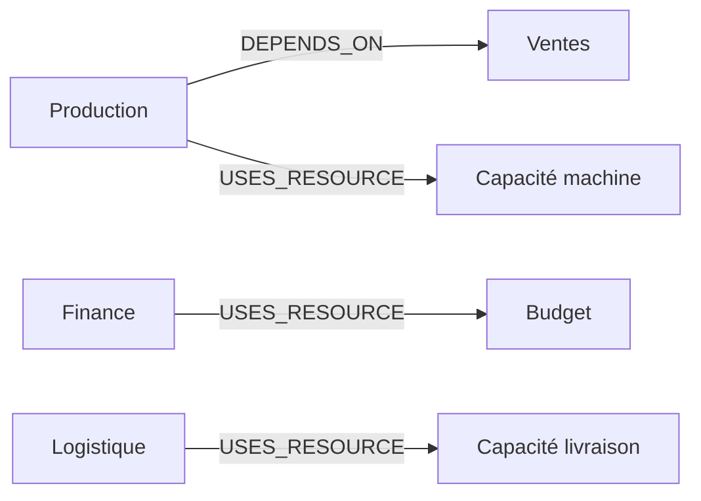

# Organization Graph — phase 3

Le graphe décrit une structure et des relations. Les équations sont déclarées
dans les fragments et les liaisons typées, puis compilées vers la DSL existante.
Il n'interprète aucun texte comme code et ne dépend ni d'un secteur ni d'un LLM.

## Contrats stricts

Voir les schémas [OrganizationModel](organization-model.schema.json) et
[OrganizationProject](organization-project.schema.json). Tous les objets rejettent
les champs inconnus. `schema_version` vaut `1.0` pour cette grammaire de composition,
distincte du schéma DSL 1.0 qu'elle produit. Identifiants et unités réutilisent les
types du kernel ; les nombres restent Decimal/Fraction jusqu'au backend de phase 2.

| Objet | Champs et rôle |
|---|---|
| Organization | id, name, version, data_snapshot_id, source, approved |
| DepartmentNode | id, name, owner_id descriptif, source/approved/version |
| ResourceNode | id, name, unit, capacity={parameter}, capacity_version, owner_department, shared_with, constraint_id, provenance |
| DependencyEdge | id, source_id, target_id, type ; aucune équation implicite |

Le registre de nœuds interdit les identités ambiguës entre organisation,
départements et ressources. Des libellés identiques restent possibles : ce ne
sont pas des identités. ActivityNode et les autres types d'ontologie ne sont pas
implémentés dans cette tranche.

Une ressource partagée garde un propriétaire responsable unique. `shared_with`
liste ses autres départements contributeurs ; une double propriété ou un membre
inconnu est rejeté. La capacité est exclusivement référencée par un paramètre
partagé approuvé et versionné, non recopiée dans chaque fragment. Elle est non
négative et son unité doit être compatible avec celle de la ressource.

## Arêtes informatives

- DEPENDS_ON : département source → département cible ; deux départements distincts.
- USES_RESOURCE : département → ressource, dans le périmètre déclaré de celle-ci.

Les extrémités et les types sont validés. Les cycles entre départements sont
autorisés : le graphe n'est pas un ordonnanceur ni une procédure à exécuter.
Une arête USES_RESOURCE sans ResourceUse ne consomme **rien de mesuré** et n'ajoute
pas de plafond. Une ressource sans liaison mathématique est affichée UNMODELED,
avec consommation/marge null. Seul ResourceUse contribue à une équation.

## Fragments et partage

Un DepartmentFragment possède id, organization_id/version, department_id/version,
source/approved/version ; il peut déclarer paramètres, variables, contraintes HARD
et contributions ResourceUse. Cette première version accepte un fragment par département.

Les paramètres locaux ont des identifiants canoniques uniques dans le modèle global.
Ils ne sont pas préfixés ou rapprochés automatiquement par leur nom d'affichage.
Les imports `parameter_refs` indiquent parameter, version, unit, owner_department
(null pour le registre partagé). Les imports `variable_refs` indiquent variable,
unit, owner_department et declaration_version (version du fragment déclarant).
Les unités d'import doivent correspondre à la déclaration, échelle comprise.
Les conversions d'unités de calcul restent celles du compilateur DSL.

Deux départements peuvent ainsi importer `qty_A` et utiliser la même colonne du
modèle global. Ils ne peuvent pas la redéclarer, même avec un contenu identique.
Les variables sont déclarées uniquement par leur département propriétaire.
Une règle locale ne peut prétendre appartenir à un autre département.

`owner_id`, `owner_department`, `shared_with` et `approved` sont des déclarations
structurelles. Ils ne simulent pas une authentification ou une approbation réelle.

## Exemples et représentation

Les projets [usine](../examples/organizations/factory/project.json) et
[université](../examples/organizations/university/project.json) contiennent des
références vers un graphe et des fichiers JSON indépendants par département.
Les données, coûts, capacités et scores sont entièrement synthétiques.

```powershell
python -m brain.organization compose examples/organizations/factory/project.json --output results/organization_factory_composed.json --mermaid results/organization_factory.mmd
python -m brain.organization solve examples/organizations/university/project.json --output results/organization_university.json --mermaid results/organization_university.mmd
```

Les exports JSON embarquent tous les nœuds, arêtes et labels. Les fichiers Mermaid
emploient des identifiants générés et des labels filtrés, sans texte Mermaid ou
HTML exécutable provenant des données. Une représentation simplifiée du cas usine :



Les valeurs mesurées, décisions pertinentes, propriétaires, contraintes associées
et traces sont dans les rapports des deux démonstrations. Ces rapports n'attribuent
aucun prix d'ombre ni cause opérationnelle aux saturations observées.
